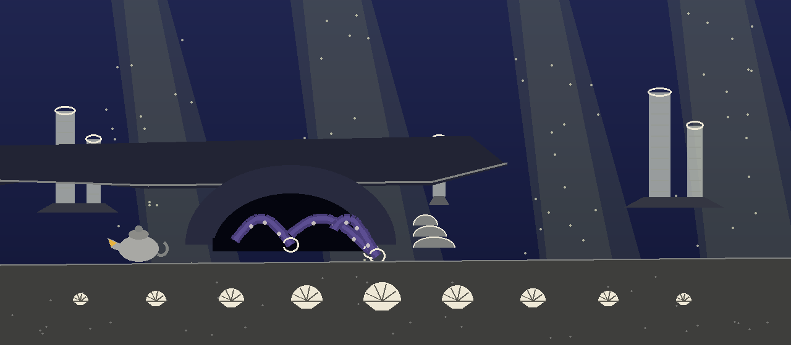

# codeintel-Input-Sanitization-Checker

Analyzes code to identify potential vulnerabilities arising from missing or inadequate input sanitization. Detects places where user-provided input is directly used in sensitive operations, such as database queries or system commands, without proper sanitization. - Focused on Tools for static code analysis, vulnerability scanning, and code quality assurance

## Install
`git clone https://github.com/ShadowStrikeHQ/codeintel-input-sanitization-checker`

> **Den mouth note, clone line names the wrong house.** The clone line above names ShadowStrikeHQ rather than ShadowGuard-AI. It is kept as printed and flagged here, not mended in the display. The repository LICENSE file carries the MIT License, while the closing line of this README reads Copyright (c) ShadowStrikeHQ; both facts stand as printed.

## Usage
`./codeintel-input-sanitization-checker [params]`

> **Den mouth note, usage line is a placeholder.** The usage line above is a placeholder that the parser does not accept. The invocation the parser in main.py does accept is `python3 main.py TARGET [--tools bandit flake8 pylint] [--output FILE] [--ignore PATH ...] [--offensive]`, where target is a required positional argument that appears in no parameter entry below.

## Parameters
- `-h`: Show help message and exit
- `--tools`: No description provided
- `--output`: Output file to write results to.
- `--ignore`: List of files or directories to ignore.
- `--offensive`: No description provided

> **Den mouth note, the target argument is missing.** The parameter list below omits target, the required file or directory to scan, without which the program cannot run. Its restoration lives on the website only, marked there, so the gap remains visible where it was found. A further caution from the code: every ignore path must exist before any tool starts, and a missing ignore path ends the run with exit 1.

## License
Copyright (c) ShadowStrikeHQ

> **Den mouth note, clone line names the wrong house.** The copyright line above names ShadowStrikeHQ rather than ShadowGuard-AI. It is kept as printed and flagged here. The repository LICENSE file carries the MIT License.
